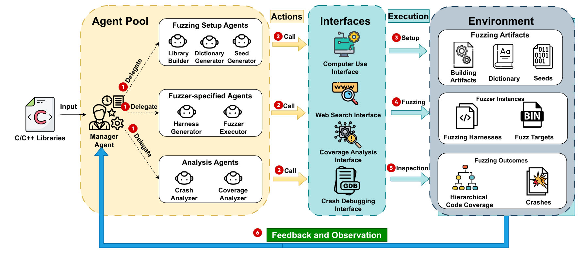
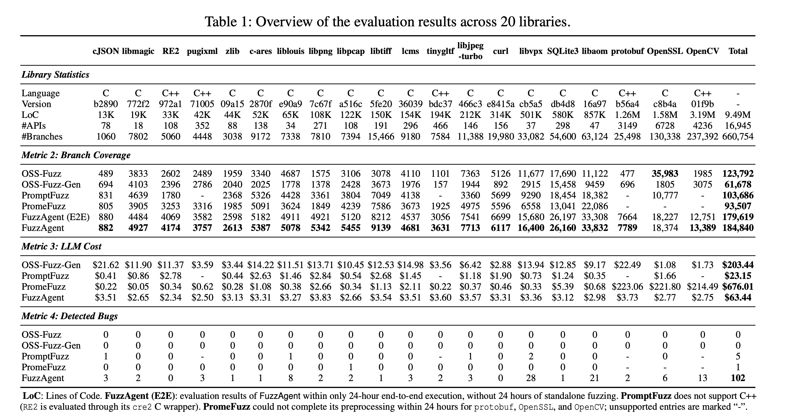

<h1 align="center">FuzzAgent</h1>

<p align="center">
  <strong>Multi-Agent System for Evolutionary Library Fuzzing</strong><br>
  From C/C++ source code to evolving fuzzing campaigns.
</p>

<p align="center">
  <a href="https://arxiv.org/abs/2605.14431"></a>
  <a href="pyproject.toml"></a>
  <a href="#quick-start"></a>
  <a href="LICENSE"></a>
</p>

<p align="center">
  <a href="https://arxiv.org/abs/2605.14431"><strong>Paper</strong></a> ·
  <a href="#quick-start"><strong>Quick Start</strong></a> ·
  <a href="#results"><strong>Results</strong></a> ·
  <a href="#benchmarks"><strong>Benchmarks</strong></a> ·
  <a href="#citation"><strong>Citation</strong></a>
</p>

---

FuzzAgent is an autonomous multi-agent system for fuzzing C/C++ libraries. Starting from source code, specialized agents collaborate to prepare builds, generate harnesses and inputs, run fuzzers, and analyze coverage and crashes. This repository provides the research prototype and launchers for the 20 libraries evaluated in the paper.

- **End-to-end automation:** Coordinate library building, dictionary and seed acquisition, harness generation, fuzzing, and analysis.
- **Dependency-aware harness generation:** Construct API sequences around initialization, state dependencies, and object lifetimes.
- **Coverage-guided evolution:** Use execution feedback to refine harnesses and explore additional program paths.

<p align="center">
  
</p>

## Results

The paper's [Table 1](https://arxiv.org/html/2605.14431v1) reports per-library statistics, branch coverage, LLM cost, and detected bugs across all 20 targets. The screenshot below preserves the full table; click it to open the original-size image.

<p align="center">
  <a href="docs/assets/paper-overall-results.png">
    
  </a>
</p>

FuzzAgent covers **184,840 branches** and reports **102 detected bugs**. By reported total branch coverage, this is **49.3%** more than OSS-Fuzz, **199.7%** more than OSS-Fuzz-Gen, **78.3%** more than PromptFuzz, and **97.7%** more than PromeFuzz; the systems cover different target sets. Its end-to-end variant covers **179,619 branches** using 24 hours of execution without an additional 24-hour standalone fuzzing phase. The other coverage results follow the paper's 24-hour execution plus 24-hour standalone fuzzing protocol. The paper explains the unsupported entries and per-system evaluation details in the table notes.

## Quick Start

Tested on **Ubuntu 24.04 LTS**, using Docker and an OpenAI-compatible LLM endpoint. Run the following commands from the repository root.

### 1. Build the Docker image

Install Docker Engine and the Docker Compose plugin using the [official guide](https://docs.docker.com/engine/install/ubuntu/), then build the image:

```bash
docker buildx build -t fuzzagent -f docker/Dockerfile .
```

### 2. Configure your LLM

```bash
cp .env_template .env
```

Edit `.env` with your endpoint, API key, and model:

```dotenv
OPENAI_BASE_URL=https://api.example.com/v1
OPENAI_API_KEY=your-api-key
OPENAI_MODEL=your-model
```

A GitHub token is optional. Create one at [github.com/settings/tokens](https://github.com/settings/tokens) and set `GITHUB_TOKEN` in `.env` to enable GitHub search.

### 3. Launch a benchmark

```bash
./benchmark/run.sh cjson
```

The launcher prepares the source checkout and starts `fuzzagent-cjson` in the background. The default campaign runs for **24 hours**, then exports full code coverage. Source and output paths are configured automatically.

## Benchmarks

Choose a library below and use its **Target ID** with `./benchmark/run.sh <target>`. Library names link to their source repositories.

The launcher caches checkouts in `.cache/targets/<target>` and saves results in `output/<target>`. It currently clones each repository's default branch; the paper's evaluation uses the specific revisions listed in Table I.

| Library | Focus | Target ID |
| :--- | :--- | :--- |
| [c-ares](https://github.com/c-ares/c-ares) | Asynchronous DNS resolution | `c-ares` |
| [cJSON](https://github.com/DaveGamble/cJSON) | JSON parsing and serialization | `cjson` |
| [curl](https://github.com/curl/curl) | Data transfer and network protocols | `curl` |
| [libaom](https://aomedia.googlesource.com/aom) | AV1 video encoding and decoding | `libaom` |
| [libjpeg-turbo](https://github.com/libjpeg-turbo/libjpeg-turbo) | JPEG encoding and decoding | `libjpeg-turbo` |
| [liblouis](https://github.com/liblouis/liblouis) | Braille translation | `liblouis` |
| [libmagic](https://github.com/file/file) | File type identification | `libmagic` |
| [libpcap](https://github.com/the-tcpdump-group/libpcap) | Network packet capture | `libpcap` |
| [libpng](https://github.com/pnggroup/libpng) | PNG encoding and decoding | `libpng` |
| [libtiff](https://github.com/libsdl-org/libtiff) | TIFF image processing | `libtiff` |
| [libvpx](https://chromium.googlesource.com/webm/libvpx) | VP8 and VP9 video encoding and decoding | `libvpx` |
| [Little CMS](https://github.com/mm2/Little-CMS) | Color management | `lcms` |
| [OpenCV](https://github.com/opencv/opencv) | Computer vision and image processing | `opencv` |
| [OpenSSL](https://github.com/openssl/openssl) | Cryptography and TLS | `openssl` |
| [Protocol Buffers](https://github.com/protocolbuffers/protobuf) | Structured data serialization | `protobuf` |
| [pugixml](https://github.com/zeux/pugixml) | XML parsing and processing | `pugixml` |
| [RE2](https://github.com/google/re2) | Regular expression matching | `re2` |
| [SQLite](https://github.com/sqlite/sqlite) | Embedded SQL database | `sqlite` |
| [TinyGLTF](https://github.com/syoyo/tinygltf) | glTF model loading and serialization | `tinygltf` |
| [zlib](https://github.com/madler/zlib) | Data compression | `zlib` |

## License

FuzzAgent is dual-licensed under **[AGPL-3.0-only](LICENSE)** or a separate **commercial license** obtained from the copyright holders. You can choose either option:
1. **Open-source license (AGPL-3.0-only)**. Use, modify, and share HarnessMinimizer under the AGPL's terms. If you distribute covered binaries, provide the corresponding source as required by the license. If you run a modified version as a network service, offer its corresponding source to users who interact with it remotely. Full terms: [LICENSE](LICENSE).

2. **Commercial license**. If you cannot or do not want to meet the AGPL requirements for your intended use, obtain a separately negotiated commercial license before proceeding. Contact fuzzanything@gmail.com. This repository does not grant a commercial license.

## Citation

If you use FuzzAgent in your research, please cite our [paper](https://arxiv.org/abs/2605.14431):

```bibtex
@misc{lyu2026fuzzagentmultiagentevolutionarylibrary,
      title={FuzzAgent: Multi-Agent System for Evolutionary Library Fuzzing},
      author={Yunlong Lyu and Peng Chen and Fengyi Wu and Junzhe Yu and Kit Long Hon and Hao Chen},
      year={2026},
      eprint={2605.14431},
      archivePrefix={arXiv},
      primaryClass={cs.SE},
      url={https://arxiv.org/abs/2605.14431},
}
```
# FuzzAgent
